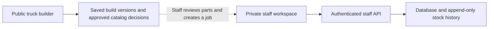

# Next Jump inventory operations

Implemented October 12, 2026. This extends the existing native inventory workbench; it does not install or integrate the reference vendors.

## Three places to work

| Area | Everyday task | Stock effect |
| --- | --- | --- |
| Stock | Find or scan a part, count a shelf, edit its bin or minimum | A physical count establishes a known opening balance. Unknown remains unknown. |
| Purchasing | Draft an order, record it as ordered, receive all or part of a delivery | Ordered units appear separately as “on order.” Only received units enter physical stock. |
| Jobs | Reserve parts, add more parts, confirm actual use, complete or cancel | Holds reduce availability. Completion deducts actual use and releases unused holds together. Cancellation releases holds without deducting stock. |

Search, status filters, sorting and server pagination remain available. Purchase orders and jobs use a detail drawer rather than separate edit pages. Receipt and completion screens show the resulting quantity change before saving. Mobile layouts adapt to cards and readable forms. Keyboard focus follows each step; dialogs support Escape and reduced-motion preferences.

Purchase orders are internal records. “Record as ordered” means a staff member already placed the order with the supplier. The app does not email vendors, spend money, create supplier commitments, pay bills or synchronize accounting.

## Barcodes

- Supports manual entry and USB/Bluetooth scanners that type into a field and finish with Enter. Physical scanner hardware has not been tested.
- Lookup opens the exact linked part. Lookup alone never changes stock.
- Multiple codes can identify one part; one exact code cannot identify two parts.
- Codes stay strings: leading zeros, letter case and internal spaces are preserved. Outer whitespace is trimmed. No guessed SKU matching or silent product creation.
- Link or remove codes in the part’s Barcodes disclosure. Barcode metadata does not invalidate product or fitment approvals.
- Camera scanning and label printing are not implemented.

## Connection and data boundaries

The private local pilot uses SQLite. Hosted code uses the Cloudflare Worker and its D1 binding. These are separate databases; local edits do not synchronize to production. Both use the same service contract.

The public builder saves immutable plans and evaluates only approved product, price and exact fitment decisions. Saving a plan does **not** reserve or consume stock. A staff member must review the scope and create the job. Public pages do not expose the stock ledger, costs, purchase orders or jobs.

At the previous verified release, production work-account configuration and the private catalog import were not enabled. This release does not change that. Schema-only migrations create operational tables; they import no private products, costs, source snapshots, counts or demo jobs. Unreviewed spreadsheet snapshots cannot become promised inventory automatically.

## Access and reliability

- Administrator: purchasing drafts, edits, ordering/cancellation and private unit costs; also inventory operations.
- Inventory staff: barcode links/lookup, stock, job operations and purchase receiving. Purchase lists, detail lines and receipt activity exclude unit costs. Legacy source payloads are restricted to catalog access.
- Catalog and sales roles do not gain inventory or purchasing access through this change.
- Verified server identity owns every action. Same-origin checks protect writes.
- Stock changes and the associated audit receipt commit in one database transaction. Unique action keys make exact retries safe. A changed payload or different actor cannot reuse a key.
- Current revisions prevent conflicting receipts, edits, cancellations and job completions from overwriting each other. One invalid participant prevents every line in the operation from saving.
- A job cannot overbook, reserve uncounted stock, consume more than held, omit a held line or complete twice. Every held part is accounted for, including zero used.
- Job and PO references are protected from manual stock actions. The history shows readable job/PO numbers and names.
- Cancelled and completed records keep their history. Received stock is not erased by cancelling outstanding order quantities.
- One order/job supports up to 25 distinct physical parts. Lists page 30 records; part search covers the full catalog. Service/labor and unclassified candidates do not become physical inventory.
- Inventory UI and CSS load only on the staff route, keeping the customer site download smaller.

## What to learn from the reference platforms

The relevance judgments below are design recommendations, not claims that these products are connected to this system.

| Reference | Verified useful pattern | Relevance for Next Jump |
| --- | --- | --- |
| [Zoho purchase receiving](https://www.zoho.com/us/inventory/help/purchase-orders/purchase-receive.html), [partial receives](https://www.zoho.com/us/inventory/kb/purchase-order/po-receives.html), [barcode settings](https://www.zoho.com/us/inventory/help/items/qrcode-generation.html) | Separate purchase orders from deliveries; receive partial quantities; match scans to a defined item field. | Primary inventory model: purchasing, arrival, known stock and an exact item identity. |
| [Tekmetric purchase orders](https://support.tekmetric.com/hc/en-us/articles/1500012315162-How-to-Manage-Your-Purchase-Orders), [inventory orders](https://support.tekmetric.com/hc/en-us/articles/360037472494-Inventory-Orders) | Distinguish inventory replenishment from parts for a repair order; handle receipts, mappings and returns. | Closest shop workflow. Separate replenishing the shelf from reserving parts for a particular customer job. |
| [Fishbowl](https://try.fishbowlinventory.com/inventory-management-system/) | Warehouse receiving, locations, traceability, work orders, bills of materials and barcode scanning. | Useful when stock locations, fabrication kits and accounting demands grow. Full warehouse/manufacturing breadth is beyond this release. |
| [ManageEngine ServiceDesk Plus](https://www.manageengine.com/products/service-desk/it-asset-management/it-inventory-management.html) | IT hardware/software inventory and asset lifecycle management. | Better suited to company computers and licenses than parts installed in customer trucks. |
| [Infor Automotive](https://www.infor.com/industries/automotive) | ERP, supplier collaboration, manufacturing, PLM, MES and warehousing for OEMs, tier suppliers and specialty manufacturers. | Traceability matters; its broader manufacturing scope is not the initial shop requirement. |
| [Knack inventory overview](https://www.knack.com/blog/what-is-an-inventory-management-system/) | Inventory systems track item movement and connect stock operations to broader workflows. | A useful conceptual overview. A spreadsheet-like surface still needs durable transactions, permissions and stock rules underneath. |

For Next Jump, prioritize reliable part identity, location/bin, known on-hand vs held vs available vs incoming, partial supplier deliveries, and actual parts consumed by jobs. The workspace borrows those patterns without adding every enterprise module to the daily screen.

## Rollout still required

1. Next Jump supplies its actual Google Workspace or Microsoft tenant/application configuration and named staff roster. Do not put secrets in Git or the frontend.
2. Shop owner reviews product classifications, barcode mappings and supplier details. Import the approved private master into production through a reviewed private import.
3. Shop staff reconcile opening physical stock and bins; imported snapshots remain evidence rather than counts.
4. Run a small shop pilot: real scanner, split delivery, over-receipt rejection, additional job parts, unused parts, cancellation and a retry after interrupted connectivity. Confirm the ledger against the shelf.
5. Before Shopify cutover, complete returns/damage adjustments, transfers as needed, accounting/valuation decisions, backups and restore verification, operational ownership and reconciliation. No cutover has occurred.

## Validation and reproducible demo

The automated suite includes barcode uniqueness/leading zeros, role and cost boundaries, partial/over receiving, stale and simultaneous retries, failed-transaction rollback, location scope, incoming quantities, job overbooking, actual-use deductions, cancellation and list pagination.

Browser QA uses a fresh synthetic database from `node scripts/seed-inventory-demo.mjs`. It creates only clearly labelled DEMO parts, purchase orders and jobs in a new temporary folder outside the repository. Start a preview with its returned folder using `PREVIEW_DATA_DIR=<folder> PORT=4177 npm start` after a build. Never point a demo seed at the real catalog or production D1.

No synthetic stock or QA receipts are published into the hosted database. Scanner input is tested with typed codes and Enter; that does not prove a specific physical scanner model.
